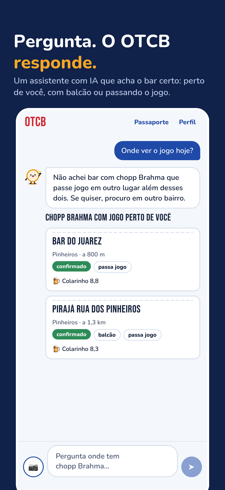
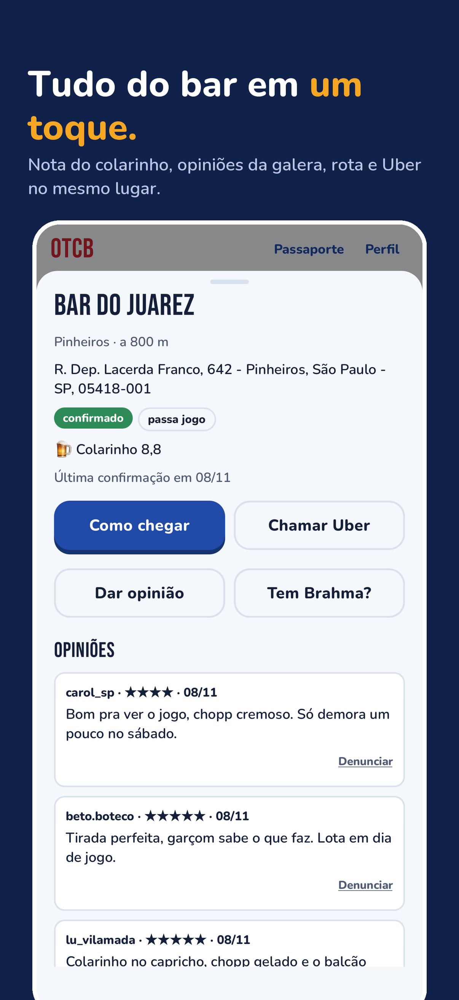

# OTCB

App que responde, em conversa, onde tem chopp bem tirado em São Paulo e se o bar passa o jogo.

**App Store:** [OTCB para iPhone](https://apps.apple.com/br/app/otcb/id6832270339)

<p>
  
  
  
</p>

## Principais funcionalidades

- **Chat com agente de IA:** a busca é em linguagem natural, e as respostas vêm em cards com bar, bairro, distância, status e mini mapa.
- **Entrada de dados dentro do chat:** confirmar um bar em um toque, dar opinião ou sugerir um bar novo, sempre por card.
- **Colarinhômetro:** foto do chopp avaliada por IA, que vira nota do bar, confirmação e carimbo.
- **Passaporte do Chopp:** carimbos, coleções e selos que premiam bares diferentes e contribuição — nunca quantidade consumida.
- **Onde ver o jogo:** jogos do dia e bares que transmitem.
- **Garimpo automático:** um robô descobre e revisita bares, atualiza coordenadas e status de funcionamento; toda evidência tem data e perde força com o tempo.
- **Opiniões com moderação** e resumo por IA.
- **Sem login:** identidade anônima por aparelho, confirmação de maioridade, apelido e "Apagar meus dados".

## Stack técnica

- **App:** React Native com Expo (Expo Router), TypeScript estrito; `react-native-maps`, `react-native-reanimated`, `expo-camera`, `expo-location`.
- **Build e publicação:** EAS Build e EAS Submit.
- **Backend:** Supabase (Postgres com RLS, autenticação anônima, `pg_cron`/`pg_net`).
- **Lógica de servidor:** Supabase Edge Functions (Deno) — agente, Colarinhômetro, garimpo, jogos, opiniões e apagar conta.
- **IA:** Claude API (Anthropic) com tool use para o agente do chat; Claude também para visão, classificação e moderação.
- **Dados externos:** Google Places API, Firecrawl (coleta web) e APIs de futebol para o calendário de jogos.
- **Telemetria:** [Visão de Produto](https://visaodeproduto.com.br/).

## Como foi construído

O OTCB foi desenvolvido com Claude (Anthropic) a partir de uma especificação no formato SDD: [`spec.md`](spec.md). Cada épico teve um plano aprovado antes da implementação, guardado em [`plans/`](plans/).

Guardrails que existem no repositório:

- **Hooks do Claude Code** em [`.claude/hooks/`](.claude/hooks/), configurados em [`.claude/settings.json`](.claude/settings.json): bloqueiam segredos no código do app, edição de migrations já versionadas, edição de testes durante correção de bug (modo `fix-mode`), uso da marca na ficha da loja e acesso à galeria na câmera; e lembram de rodar os advisors do Supabase.
- **Agente verificador** ([`.claude/agents/verifier.md`](.claude/agents/verifier.md)), que confere em contexto limpo cada épico contra os critérios de aceite da spec.
- **Instruções de revisão** em [`REVIEW.md`](REVIEW.md).
- **Testes:** Jest + Testing Library no app ([`__tests__/`](__tests__/)), pgTAP no banco ([`supabase/tests/`](supabase/tests/)) e `deno test` nas Edge Functions, além de typecheck, lint e `expo export` como checagem de build.

## Status

Publicado na App Store (iPhone).

## Rodar localmente

Requisitos: Node 22+, npm, Docker, [Supabase CLI](https://supabase.com/docs/guides/cli) 2.x, Deno 2.x e `jq` (usado pelos hooks de `.claude/hooks/`).

```bash
npm install
cp .env.example .env          # preencha as chaves públicas
supabase start                # stack local do Supabase
npm start                     # Expo (dev server)
```

O stack local serve para rodar os testes pgTAP e testar migrations antes de aplicá-las no banco remoto.

Verificação completa:

```bash
npm run typecheck && npm run lint && npm test && npm run test:db && npm run test:functions && npm run build:check
```

As chaves das APIs externas (Anthropic, Google Places, Firecrawl, futebol) ficam só como secrets das Edge Functions; nenhum segredo vai para `app/` ou `src/`.

Migrations: cada mudança de esquema é um arquivo novo em `supabase/migrations/` (migration versionada nunca se edita), testado localmente com `supabase db reset && npm run test:db` antes de ir para o banco remoto.

## Licença

O código está disponível apenas para leitura e estudo. Veja [LICENSE](LICENSE).

## Contribuições

Issues são bem-vindas; pull requests não são aceitos. Veja [CONTRIBUTING.md](CONTRIBUTING.md).

---

Feito pela [Dab Lab](https://www.dablab.com.br/) — agência de inovação no-code para startups e PMEs, com automações usando IA.
